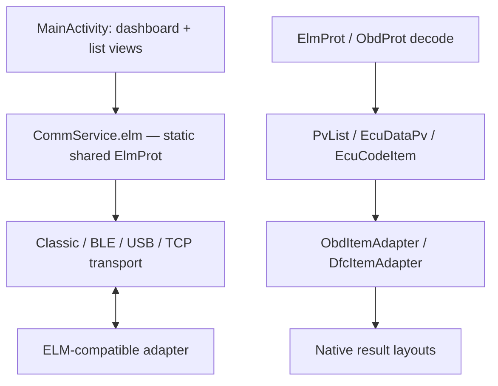

# Repository Guidelines

Bengkel Scan is a fork of [AndrOBD](https://github.com/fr3ts0n/AndrOBD) (GPL-3.0): an offline, Indonesian-language
OBD-II app for one shared workshop phone. Upstream provides read-only OBD diagnostics; the fork adds an offline
workshop data layer (customers, vehicles, service records, estimate items), scanner-independent diagnostic records
with offline repair guides, and a guided symptom checklist for mechanical-injection diesel vehicles that have no ECU.

## Project Overview

Workshop rules, safety text and terminology are authoritative in `README.md` (Indonesian) and `docs/`. This file is
what an assistant needs before touching code.

Operating constraints that shape every change:

- One phone, one database, no accounts, no server, no network dependency. Fork features are fully offline.
- The user is a mechanic, not a developer: UI is Indonesian, wording follows `docs/workshop-glossary.md`, and every
  output keeps a visible "suggestion only, the mechanic decides" disclaimer.
- Content never invents specifications. If a reference is missing, the UI says so.

## Architecture & Data Flow

Three Gradle modules; the app module is `:androbd`, **not** `app/`.

- `:library` — plain Java (`apply plugin: 'java'`, no Android imports allowed). ELM/OBD protocol (`ecu/prot/obd`),
  PID/fault-code models, conversions, stream handling, `pvs` process variables. Legacy GUI packages are excluded in
  `library/build.gradle`; text/CSV resources ship from `src/main/java/.../obd/res/`.
- `:androbd` — Android app: `namespace com.fr3ts0n.ecu.gui.androbd`, Java 17, `minSdk 23`, `compileSdk/targetSdk 37`.
- `:plugin` — upstream extension framework, a git submodule. **Not** a workshop storage module; never use it as one.
  It pins its own Gradle daemon toolchain to JDK 21 while the app modules need 17.

Root package `com.fr3ts0n.ecu.gui.androbd` holds the OBD surface: `MainActivity` (a single activity that swaps views
and adapters — the four "screens" are not separate activities), `CommService` (+ `Bt`/`Ble`/`Usb`/`Network`
subclasses), `ObdItemAdapter`/`DfcItemAdapter`, `ObdUiLabels`/`ObdUiValues` (presentation-only localization),
`ModernUiUtils`, `SettingsActivity`. The `*CommService` classes are **not** Android `Service` subclasses: there is no
background reader or recorder service.



Two fork-owned packages stay independent of that stack — they never call `ElmProt`, `ObdProt`, `CommService` or
`EcuDataPv`; keep it that way:

- `workshop/` — persistence. `WorkshopDatabase` (`SQLiteOpenHelper`, `SCHEMA_VERSION = 3`, additive `onUpgrade`) →
  `WorkshopRepository` (customers/vehicles/services/estimate items) and `DiagnosticRepository` (one evidence row per
  service+module) → `workshop/ui/*Activity`; `WorkshopArchive`/`WorkshopBackup` export/restore; `guidance/` holds the
  resource-backed offline repair guides.
- `diagnosis/` — scanner-free diagnosis in three layers: `core/` (immutable `DiagnosisKnowledge`, validator,
  `DiagnosisScorer`, `CheckStatus`, `DiagnosisCaseHistory`), `data/` (`DiagnosisKnowledgeLoader`, `DiagnosisRepository`,
  `DiagnosisMediaStore`, `DiagnosisServiceLink`), `ui/` (Start → Questions → Results → Case, `SoundGuideActivity`,
  `DiagnosisAudioPlayer`).

Guided flow: bundled JSON → `DiagnosisKnowledgeLoader` (validated) → answers + `CheckStatus` → `DiagnosisScorer` ranks
causes → mechanic records evidence and a *mechanic-authored* final assessment → `DiagnosisRepository` rows +
`DiagnosisMediaStore` private files → `WorkshopArchive` on backup. `DiagnosisServiceLink` is the only code that turns a
case into an estimate item, and it never picks the quantity or price.

Invariants enforced in code (do not relax one layer assuming another covers it):

- Money is integer Rupiah; quantities may be fractional. Enums persist by name, never ordinal. Foreign keys are
  enabled in `onConfigure` and cascade customer → vehicle → service → estimate/diagnosis rows.
- `conclusion = CONFIRMED` requires `read_status = READ` plus diagnosis, procedure, result and reference (DB `CHECK`
  plus `DiagnosticRepository.validate()`); a confirmed diagnosis check requires stored evidence (DB `CHECK`,
  `DiagnosisRepository.validateProgress/saveFinal`, and the UI gate).
- Editing any answer or check demotes the case to `DRAFT` and clears `mechanic_confirmed`.
- `DiagnosisKnowledge` is immutable and closed-schema: unknown JSON fields, duplicate IDs, out-of-range weights and
  unsafe paths are rejected. `verified` is review status, never a case state or a test result.
- `DiagnosisRepository.validateDatabase` is the restore-time integrity gate; never bypass it for a faster restore.

## Key Directories

| Path | Purpose |
| --- | --- |
| `androbd/src/main/java/com/fr3ts0n/ecu/gui/androbd/` | App code: OBD surface at the root, `workshop/`, `diagnosis/` |
| `androbd/src/main/res/values/` | English base strings, layouts, menus, themes |
| `androbd/src/main/res/values-in/` | Indonesian strings (`values-in` is the legacy Android qualifier used here) |
| `androbd/src/main/assets/diagnosis/knowledge-base.json` | Bundled diagnosis content (~120 KB, all `verified: false`) |
| `androbd/src/test/` | JVM tests (JUnit 4) |
| `androbd/src/androidTest/` | Instrumented tests (JUnit 4 + `AndroidJUnitRunner`) |
| `library/src/main/java/com/fr3ts0n/` | Protocol and data model; `ecu/prot/obd/res/` holds CSV/properties assets |
| `library/.../ecu/prot/obd/res/codes_id.properties` | 3,584 Indonesian fault-code descriptions (explicit bundle) |
| `docs/` | `diagnosis-knowledge-base.md`, `workshop-glossary.md`, upstream menu notes |
| `plugin/` | Git submodule — extension framework |

## Development Commands

```bash
export ANDROID_HOME="$HOME/Android/Sdk"
export PATH="$ANDROID_HOME/platform-tools:$PATH"
git submodule update --init --recursive            # required once, or every Gradle task fails
./gradlew :androbd:assembleDebug                   # → androbd/build/outputs/apk/debug/androbd-debug.apk
./gradlew :library:test :androbd:testDebugUnitTest # JVM tests only, no phone
./gradlew :androbd:lint                            # lint, baseline-grandfathered

export ANDROID_SERIAL=<serial shown by adb devices -l>
adb install -r androbd/build/outputs/apk/debug/androbd-debug.apk
adb shell am start -W -n com.fr3ts0n.ecu.gui.androbd/.MainActivity
adb logcat --pid="$(adb shell pidof -s com.fr3ts0n.ecu.gui.androbd | tr -d '\r')"
```

`./gradlew build` is what CI runs (compile + JVM tests + lint). Instrumented suites need both APKs installed:

```bash
./gradlew :androbd:assembleDebug :androbd:assembleDebugAndroidTest
adb install -r androbd/build/outputs/apk/androidTest/debug/androbd-debug-androidTest.apk
adb shell am instrument -w -e class <comma,separated,FQCNs> \
  com.fr3ts0n.ecu.gui.androbd.test/androidx.test.runner.AndroidJUnitRunner
```

## Code Conventions & Common Patterns

- Java only — zero Kotlin sources. Match the indentation of the file you edit: tabs in the root package and
  `workshop/`, 4 spaces in `diagnosis/`. Upstream code and fork code differ; never reformat a whole file.
- Logging: `java.util.logging.Logger` in root/upstream classes, `android.util.Log` with a feature tag
  (`Log.e("Diagnosis", …)`) in the fork packages. Never `System.out`, `printStackTrace()`, or an empty `catch`.
- All UI text is a string resource — `values/` (English) and `values-in/` (Indonesian) — never a Java literal. Code,
  comments, identifiers and commit messages are English. `MissingTranslation` lint is disabled, so a missing locale
  fails silently: check the pair yourself.
- Per-file language varies: `values/diagnosis*.xml` already holds Indonesian (identical to `values-in/`, and only
  `values/` carries the `<item type="id">` declarations), while `values/strings.xml`, `values/workshop_*.xml` and
  `values/obd_*.xml` hold English. Verify the file before adding copy.
- Resource names are feature-prefixed and two similar prefixes are unrelated: `diagnosis_*` (guided, no-scanner flow)
  vs `diagnostic_*` (per-service scanner evidence). Also `workshop_*`, `home_*`, `obd_label_*`/`obd_value_*`.
- Every activity calls `SettingsActivity.applyLocale(...)` as the first statement of `onCreate`; new activities must
  be registered in `AndroidManifest.xml` (`exported="false"` except the launcher) or they throw at runtime.
- Screens are built with the shared helpers (`WorkshopUi.prepare/money/statusLabel`, `DiagnosisUi.screen/text/button`)
  and `ModernUiUtils.applyScreenInsets`, not ad-hoc builders, so insets and the disclaimer stay consistent.
- Background work is per-screen: a `SingleThreadExecutor` field plus `Handler(Looper.getMainLooper())` for UI hops, or
  one `new Thread(...)` for a one-shot import. Repositories are synchronous and callers keep SQL off the UI thread.
  Shut down executors and stop media on lifecycle end. `ExportTask extends AsyncTask` is legacy — do not copy it.
- Failures in `workshop/` and `diagnosis/` are `IllegalArgumentException` with a stable snake_case reason key
  (`confirmation_evidence_required`, `estimate_quantity_invalid`, …). Keys are for code and tests; users see an
  Indonesian string resource.
- Do not upgrade uncertainty: "no data" is never "healthy", "ranked first" is never "confirmed", and a similar sound
  never proves the same cause. Score weights are explainable rule deltas, not probabilities.
- `WorkshopFeatures` flags are build-time (`SHOW_ADVANCED_FEATURES`, `SHOW_ACTUATOR_TEST_CONTROLS`,
  `SHOW_CLEAR_FAULT_CODES`, all `false`). Hiding a control means gating its handler, restore-state path and every call
  site — visibility alone is not a control.
- Branding has one rename point (`app_name`); package ID and `logo`/`ic_launcher*` resource names stay upstream.
  Raw value, conversion and presentation stay separate: never rename a PID mnemonic or unit to translate a label.
- No new dependencies until an existing component is proven insufficient; fork code uses Android built-ins only
  (`org.json`, `SQLiteOpenHelper`, `MediaPlayer`, `MediaRecorder`, `AtomicFile`). No Room, Hilt, Compose, Retrofit or
  WorkManager — adding one would be a new convention.
- Media stays inside `files/diagnosis/`: reject absolute, traversal, network and ambiguous paths and re-verify the
  canonical prefix. Recording is ≤15 s, foreground only, and only for a mechanic-confirmed case.

## Important Files

- `androbd/src/main/AndroidManifest.xml` — launcher, gated activities, `RECORD_AUDIO`, `${applicationId}.provider`.
- `androbd/build.gradle` — SDK levels, Java 17, lint baseline, dependency versions; `library/build.gradle` — Java
  module, JUnit 5 platform.
- `settings.gradle`, `build.gradle`, `gradle/wrapper/gradle-wrapper.properties` — AGP 9.3.1, Gradle 9.7.0.
- `workshop/WorkshopDatabase.java` — schema, migrations, `final Context appContext`.
- `workshop/WorkshopArchive.java` — ZIP manifest, entry whitelist, staged restore and rollback.
- `diagnosis/data/DiagnosisRepository.java` — case tables, evidence gates, `validateDatabase`.
- `diagnosis/core/DiagnosisKnowledgeValidator.java` — content rules with stable error keys.
- `docs/diagnosis-knowledge-base.md` — JSON schema, merge/import semantics, limits, senior-mechanic review checklist.
- `docs/workshop-glossary.md` — canonical Indonesian terminology; reuse those words.
- `README.md` — installation, usage, development rules, test commands, troubleshooting.

## Runtime/Tooling Preferences

- JDK 17, Gradle wrapper only, Android SDK with **platform 37** installed (35/36 is insufficient).
- No Kotlin, no Makefile, no scripts directory, no formatter or checkstyle. Quality gate = AGP `lint` with
  `baseline = lint-baseline.xml`; new findings fail the build, so do not edit the baseline to silence one.
- `org.gradle.configuration-cache=true`, `org.gradle.workers.max=2`, `-Xmx4g`. A cold build needs Maven
  Central/Google/JitPack; `--offline` works only with a warm cache.
- Testing targets a physical phone over ADB. Demo content comes from the app's own Latihan (demo) mode, not from
  rejecting a Bluetooth permission prompt.

## Git Rules

- Work on `bengkel-custom` or a descendant. `master` is the untouched upstream snapshot.
- `upstream` push is mechanically disabled — never attempt it. Push `origin` only when asked.
- Conventional Commits in English (`feat:`, `fix:`, `docs:`), imperative subject, body as behaviour bullets.
- No VINs, customer identities, signing keys or local environment files in Git. Locale files for upstream strings are
  Weblate-managed; fork strings are edited here deliberately.

## Testing & QA

- Two suites only. `androbd/src/test/` is JUnit 4 (`:androbd:testDebugUnitTest`) and cannot call `android.*`
  framework methods (no Robolectric, no `returnDefaultValues`); pure logic — scoring, history, guide catalog, theme
  preference migration with a hand-written fake — belongs there. `library/src/test/` is JUnit 5 Jupiter
  (`:library:test`), package-private classes, and needs `Messages.init(...)` in `@BeforeAll` when conversion labels
  are asserted.
- Instrumented tests are JUnit 4 + `AndroidJUnitRunner` with `ActivityScenario`, real repositories and real rows.
  There is no Espresso, UiAutomator, Mockito or coverage tooling: UI is located by walking the accessibility tree
  (`getUiAutomation().getRootInActiveWindow()`) and acting through `ACTION_CLICK`/`ACTION_SET_TEXT` with bounded
  polling loops, never `Thread.sleep`.
- Isolate state: either a uniquely named private database (`new WorkshopDatabase(context, "guided-test-" + UUID…)`)
  deleted in teardown with its `-wal`/`-shm`/`-journal`/`.before-restore` siblings, or the process-wide database plus
  per-test fixtures named `… fixture` deleted via `deleteCustomer` (cascades). Never reset the shared singleton. Delete
  temp zips, WAVs, photos and metadata JSONs the test created.
- Name tests as behaviour sentences (`matchingRulesAddSignedWeightsAndOnlyTheirExplanations`), put the contract or the
  actual value in the assertion message, and state the test's allowed scope in one class Javadoc line.
- Focused suites only: passing a long class list to one `am instrument` is slow and the phone is shared. The real
  microphone test (`DiagnosisRecordingInstrumentedTest`) takes minutes and runs alone with `GrantPermissionRule`.
- Some tests couple to private fields by reflection (dialog fields in the results/case activities) and to exact
  string resources: renaming either breaks tests silently at runtime.
- Add a test that fails without a behaviour change. For UI or media work, also install and exercise the flow on the
  phone and read logcat — a green build proves nothing about permissions, recording, layout or real adapters.
- Known gaps: no transport (`CommService` family), `SettingsActivity`, `plugin` module or PDF/invoice test exists;
  CI never runs instrumented tests; JVM tests prove no layout or device behaviour.
