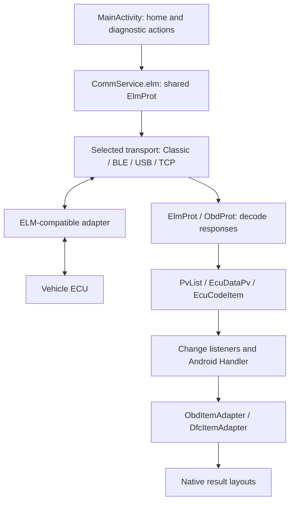

# Bengkel Scan

**Aplikasi pemeriksaan OBD-II berbahasa Indonesia untuk bengkel, dikembangkan dari [AndrOBD](https://github.com/fr3ts0n/AndrOBD) karya fr3ts0n dan para kontributornya.**

Fork ini menyederhanakan antarmuka agar mekanik mudah membaca Kode Kerusakan, Data Langsung, Data Saat Kerusakan, dan Informasi Kendaraan. Sasaran penggunaannya adalah bengkel kecil dengan satu ponsel bersama, terutama untuk kendaraan diesel yang mendukung OBD-II.

- **Branch pengembangan:** [`bengkel-custom`](https://github.com/baniputrabangsawan/Bengkel-Scan/tree/bengkel-custom).
- **Platform:** Android 6.0 / API 23 atau lebih baru.
- **Bahasa:** Indonesia secara bawaan; English dan pilihan bahasa upstream tetap tersedia.
- **Koneksi:** Bluetooth Classic, Bluetooth Low Energy (BLE), USB serial melalui OTG, serta Wi-Fi melalui TCP.
- **Tanpa kendaraan:** tersedia Mode Latihan dengan data simulasi.
- **Lisensi:** [GNU GPL-3.0](LICENSE); atribusi upstream tetap dipertahankan.

> **Status saat ini:** aplikasi diagnostik OBD dengan antarmuka bengkel, **belum aplikasi manajemen bengkel lengkap**. Database pelanggan, catatan servis otomatis, estimasi biaya, PDF, invoice, backup database, dan checklist gejala belum tersedia. Jangan menganggap hasil pembacaan sudah tersimpan sebagai riwayat servis.

## Daftar isi

1. [Fitur dan batasan](#fitur-dan-batasan)
2. [Perangkat dan keselamatan](#perangkat-dan-keselamatan)
3. [Instalasi dan build dari source](#instalasi-dan-build-dari-source)
4. [Penggunaan aplikasi](#penggunaan-aplikasi)
5. [Jenis sambungan dan cara menghubungkan](#jenis-sambungan-dan-cara-menghubungkan)
6. [Memahami hasil pemeriksaan](#memahami-hasil-pemeriksaan)
7. [Arsitektur aplikasi](#arsitektur-aplikasi)
8. [Panduan pengembangan](#panduan-pengembangan)
9. [Pengujian dan log](#pengujian-dan-log)
10. [Troubleshooting](#troubleshooting)
11. [Roadmap](#roadmap)
12. [Lisensi dan kredit](#lisensi-dan-kredit)

## Fitur dan batasan

| Area | Tersedia pada branch ini |
| --- | --- |
| Beranda pemeriksaan | Status alat scan, tindakan sambung/putus, empat pintasan pemeriksaan |
| Kode Kerusakan / DTC | Pembacaan kode tersimpan, tertunda, dan permanen jika didukung ECU |
| Data Langsung | Nilai sensor, satuan, serta status kesiapan; parameter bergantung kendaraan |
| Data Saat Kerusakan | Freeze frame jika ECU menyediakan; baca Kode Kerusakan terlebih dahulu |
| Informasi Kendaraan | Informasi OBD yang dikirim ECU; tidak semua kendaraan mengirim VIN atau semua identitas |
| Mode Latihan | Data contoh untuk belajar tanpa alat scan dan tanpa kendaraan |
| Tema | Terang, gelap, dan mengikuti sistem |
| Tentang Aplikasi | Kredit AndrOBD, pemberitahuan lisensi, dan tautan proyek asli |
| Pencarian DTC di web | Tekan lama kode; memerlukan aplikasi pencarian/browser dan internet |

### Fitur upstream yang sengaja disembunyikan

Grafik, gauge/dashboard, HUD, pengaturan tampilan lanjutan, pengelolaan plugin, serta menu Simpan/Buka hasil pemeriksaan masih memiliki implementasi upstream, tetapi disembunyikan dari alur bengkel. Penyembunyian menu Simpan/Buka **tidak digantikan penyimpanan otomatis**.

**Hapus Kode Kerusakan dan Uji Aktuator OBD juga disembunyikan.** Fork ini ditujukan untuk pembacaan diagnostik; jangan mengaktifkan kontrol aktuator atau penghapusan kode untuk penggunaan bengkel normal. Penghapusan kode belum dilengkapi audit yang terhubung ke catatan servis.

### Batas kompatibilitas kendaraan

- Kendaraan harus mempunyai ECU dan mendukung layanan/protokol OBD yang dapat diakses alat ELM327 yang digunakan. Bentuk soket saja tidak membuktikan kompatibilitas.
- Diesel injeksi mekanis tanpa ECU **tidak dapat didiagnosis melalui OBD**. Checklist gejala untuk kendaraan tersebut masih dalam roadmap.
- Truk dengan J1939, konektor khusus, atau protokol pabrikan tidak otomatis didukung. Kabel pengubah bentuk konektor tidak menerjemahkan protokol.
- ABS, airbag/SRS, transmisi, coding, regenerasi DPF paksa, dan fungsi servis khusus pabrikan **tidak dijanjikan tersedia**. Aplikasi ini bukan pengganti scanner pabrikan.
- Parameter seperti tekanan rail, turbo, EGR, dan DPF hanya muncul bila kendaraan menyediakan PID yang didukung.
- Pilihan transport yang tersedia di kode bukan sertifikasi bahwa semua merek alat akan bekerja.

## Perangkat dan keselamatan

Siapkan:

1. Ponsel Android API 23+; USB host/OTG diperlukan jika memakai USB.
2. Alat scan kompatibel ELM327 dengan jenis sambungan yang sesuai ponsel.
3. Kendaraan dengan dukungan OBD yang sesuai.
4. Kabel OTG dan kabel data, hanya untuk sambungan USB.

**Sebelum menyambungkan:**

- Parkir di tempat aman, aktifkan rem parkir, dan tempatkan transmisi pada posisi aman sesuai prosedur kendaraan.
- Cari lokasi soket diagnostik dari buku kendaraan; jangan memaksa konektor.
- **Periksa tegangan sistem kendaraan dan rating alat scan.** Banyak truk memakai 24 V; alat khusus 12 V tidak boleh dipasang pada sistem 24 V tanpa dukungan yang jelas dari produsennya.
- Ikuti prosedur pabrikan saat memasang alat. Untuk mulai membaca, biasanya kontak pada posisi **ON** sudah diperlukan; mesin tidak selalu harus hidup.
- Jika mesin harus hidup untuk pembacaan tertentu, pastikan ventilasi aman dan jauhkan tangan/kabel dari bagian bergerak atau panas.
- Jangan mengoperasikan ponsel sambil mengemudi. Jangan meninggalkan adaptor terpasang tanpa mempertimbangkan konsumsi aki dan keamanan aksesnya.

Koneksi berhasil ke alat scan belum tentu berarti ECU sudah menjawab. Tunggu inisialisasi dan pastikan data benar-benar diterima dari kendaraan.

## Instalasi dan build dari source

### 1. Pilih source yang benar

Versi di F-Droid atau halaman rilis **AndrOBD upstream bukan build Bengkel Scan ini**. Untuk memperoleh modifikasi bengkel, build branch `bengkel-custom` dari fork ini atau gunakan APK fork yang dibagikan pembuatnya.

Nama berkas dokumentasi utama adalah `README.md`, mengikuti konvensi GitHub; tidak perlu membuat salinan `readme.md`.

### 2. Kebutuhan pengembang

Android Studio **tidak wajib**. Alur berikut memakai terminal Linux dan ponsel fisik lewat USB.

| Komponen | Konfigurasi repository |
| --- | --- |
| JDK | 17 |
| Gradle | Wrapper 9.7.0; gunakan `./gradlew`, bukan Gradle sistem |
| Android Gradle Plugin | 9.3.1 |
| `compileSdk` / `targetSdk` | 37 pada `androbd` dan `plugin` |
| `minSdk` | 23 |
| SDK Platform | API 37; ID paket pada SDK yang diperiksa: `platforms;android-37.0` |
| Build Tools | 36.0.0 tersedia pada lingkungan build yang berhasil; versi tidak dikunci eksplisit dalam `build.gradle` |
| Platform Tools | `adb` |
| Git submodule | `plugin`, wajib diinisialisasi pada commit yang dikunci repository |

> SDK API 35/36 saja tidak cukup untuk checkout ini. Angka SDK pada file Gradle adalah acuan; beberapa dokumentasi upstream masih menyebut versi lama.

Pasang Git, JDK 17, dan Android command-line tools terlebih dahulu. Petunjuk resmi: [Android SDK command-line tools](https://developer.android.com/tools).

Jika SDK berada di `~/Android/Sdk`, gunakan:

```bash
export JAVA_HOME=/usr/lib/jvm/java-17-openjdk-amd64
export ANDROID_HOME="$HOME/Android/Sdk"
export PATH="$JAVA_HOME/bin:$ANDROID_HOME/platform-tools:$ANDROID_HOME/cmdline-tools/latest/bin:$PATH"

java -version
adb version
sdkmanager --list
sdkmanager "platform-tools" "platforms;android-37.0" "build-tools;36.0.0"
sdkmanager --licenses
```

Sesuaikan `JAVA_HOME` jika lokasi JDK berbeda. Baca dan terima lisensi SDK sendiri. Jika versi command-line tools Anda menampilkan ID paket API 37 berbeda, gunakan ID yang tercantum pada `sdkmanager --list`. Pada tools baru yang menandai `sdkmanager` deprecated, ikuti arahan migrasi CLI Android yang ditampilkan tools tersebut.

### 3. Clone beserta submodule

```bash
git clone --branch bengkel-custom --recurse-submodules \
  https://github.com/baniputrabangsawan/Bengkel-Scan.git
cd Bengkel-Scan
git submodule update --init --recursive
```

Jika sudah mempunyai clone fork ini:

```bash
git switch bengkel-custom
git pull --ff-only origin bengkel-custom
git submodule update --init --recursive
```

Simpan perubahan lokal sebelum berpindah branch. Jangan mengganti commit submodule dengan `git submodule update --remote` hanya untuk mencoba memperbaiki build.

### 4. Build APK debug

```bash
./gradlew :androbd:assembleDebug
```

Output:

```text
androbd/build/outputs/apk/debug/androbd-debug.apk
```

Build pertama memerlukan internet untuk Gradle dan dependensi dari Google Maven, Maven Central, serta JitPack. Diagnostik lokal tidak memerlukan internet setelah aplikasi terpasang. `./gradlew --offline :androbd:assembleDebug` hanya bekerja bila seluruh dependensi sudah ada di cache.

Jika SDK tidak terdeteksi, pastikan `ANDROID_HOME` menunjuk folder yang benar. Alternatifnya buat `local.properties` lokal dengan baris `sdk.dir=/lokasi/absolut/Android/Sdk`; jangan commit file lingkungan pribadi tersebut.

APK debug cocok untuk pengembangan, bukan distribusi produksi. Build release memerlukan penandatanganan dan pengelolaan keystore tersendiri; repository ini tidak menyediakan kunci produksi.

### 5. Hubungkan ponsel untuk instalasi

1. Aktifkan **Developer options** dan **USB debugging** di Android.
2. Sambungkan kabel USB yang mendukung data.
3. Buka kunci ponsel dan setujui fingerprint komputer jika diminta.
4. Periksa perangkat:

```bash
adb devices -l
```

Pilih serial ponsel dari keluaran tersebut, terutama bila emulator/perangkat lain juga terhubung:

```bash
read -r -p "Serial ponsel dari adb devices: " ANDROID_SERIAL
export ANDROID_SERIAL
APP=com.fr3ts0n.ecu.gui.androbd

adb install -r androbd/build/outputs/apk/debug/androbd-debug.apk
adb shell am start -W -n "$APP/.MainActivity"
```

`ANDROID_SERIAL` mengarahkan perintah `adb` berikutnya ke ponsel pilihan. Nama aplikasi di launcher adalah **Bengkel Scan**, tetapi package ID tetap `com.fr3ts0n.ecu.gui.androbd`.

> **Penting jika AndrOBD sudah terpasang:** package ID yang sama dapat menimbulkan konflik tanda tangan dengan build dari F-Droid atau sumber lain. `adb install -r` memperbarui aplikasi hanya jika tanda tangannya cocok. Jangan langsung uninstall atau menjalankan `pm clear`: tindakan tersebut dapat menghapus data/pengaturan. Cadangkan data yang tersedia melalui instalasi lama terlebih dahulu; fork ini belum mempunyai backup database bengkel.

## Penggunaan aplikasi

### Mengenal beranda

| Bagian | Penggunaan |
| --- | --- |
| Koneksi alat scan | Menunjukkan Mode Latihan, belum terhubung, proses menyambung, atau alat terhubung |
| Tombol sambungan | Mengatur alat ketika demo, memulai koneksi ketika offline, atau memutus koneksi ketika online |
| Kode Kerusakan | Membaca petunjuk gangguan dari ECU |
| Data Langsung | Memantau nilai sensor dan status yang tersedia |
| Data Saat Kerusakan | Membaca kondisi yang disimpan ECU ketika terjadi gangguan |
| Informasi Kendaraan | Melihat identitas/informasi OBD yang disediakan ECU |
| Pengaturan | Mengatur sambungan, parameter, bahasa, satuan, dan tema |
| Tentang aplikasi | Membaca kredit dan lisensi |

Saat belum terhubung, pilihan pemeriksaan dinonaktifkan. Pada Mode Latihan, data diberi penjelasan bahwa itu **contoh, bukan hasil pemeriksaan kendaraan Anda**.

### Mencoba tanpa alat: Mode Latihan

1. Buka **Pengaturan → Opsi OBD → Jenis Sambungan Alat Scan…**. Jika sedang demo, tombol **Atur Alat Scan** membuka Opsi OBD langsung.
2. Pilih **Mode Latihan**, lalu kembali ke layar utama.
3. Jika pilihan alamat ECU muncul, pilih salah satu ECU contoh, misalnya ECM pertama. Daftar tersebut bukan daftar kendaraan nyata di sekitar Anda.
4. Buka **Kode Kerusakan**, lalu kembali melalui panah kiri pada toolbar.
5. Buka **Data Langsung** dan tunggu data contoh terisi.
6. Coba **Informasi Kendaraan** serta pilihan **Data Saat Kerusakan** jika sudah tersedia.
7. Untuk menghentikan demo, gunakan tindakan putus sambungan. Jika jenis sambungan masih Mode Latihan, tombol **Mulai Mode Latihan** dapat memulainya lagi.

Tidak perlu menolak izin Bluetooth atau sengaja mematikan Bluetooth untuk masuk demo. Pilih Mode Latihan secara eksplisit.

### Alur pemeriksaan kendaraan nyata

1. Siapkan kendaraan dengan aman dan pasang alat sesuai petunjuk produsennya.
2. Atur jenis sambungan menggunakan panduan berikut.
3. Kembali ke beranda, gunakan **Hubungkan Alat Scan** jika koneksi belum dimulai otomatis, lalu tunggu inisialisasi.
4. Jika diminta alamat ECU, pilih ECU sesuai kendaraan/dokumentasi alat; jangan menganggap semua alamat adalah mesin yang sama.
5. Baca **Kode Kerusakan** dahulu. Catat kode beserta statusnya, keluhan pelanggan, dan kondisi kendaraan di catatan kerja terpisah.
6. Buka **Data Saat Kerusakan** jika tersedia dan pilih kode pada pemilihnya.
7. Buka **Data Langsung** untuk membandingkan pembacaan dengan spesifikasi serta kondisi kerja mesin.
8. Buka **Informasi Kendaraan** jika diperlukan.
9. Setelah selesai, **Putuskan Sambungan**, lalu lepas alat sesuai prosedur kendaraan.

Kembali ke beranda tidak sama dengan memutus sambungan. Jangan mengandalkan aplikasi sebagai perekam background: komunikasi dikelola bersama lifecycle activity dan tidak dijanjikan bertahan ketika aplikasi ditutup/dihentikan.

### Bahasa, tema, dan parameter

- **Pengaturan → Pengaturan umum → Bahasa / Language:** pilih Bahasa Indonesia atau English. Muat ulang aplikasi bila layar lama belum memperbarui teks.
- **Pengaturan → Pengaturan umum → Tema:** Terang, Gelap, atau Ikuti sistem.
- **Pengaturan → Opsi OBD → Parameter data yang ditampilkan:** memilih parameter yang ditampilkan; pilihan tidak membuat ECU mendukung parameter baru.
- Pengaturan satuan tersedia pada Pengaturan umum. Pastikan satuan yang dipakai ketika membandingkan dengan manual servis.

## Jenis sambungan dan cara menghubungkan

**Jenis sambungan adalah jalur ponsel ke alat scan, bukan protokol alat scan ke ECU.** Contohnya, Bluetooth dapat dipakai oleh alat yang berbicara CAN atau protokol OBD lainnya ke kendaraan.

Semua jenis dipilih melalui **Pengaturan → Opsi OBD → Jenis Sambungan Alat Scan…**. Pengaturan **Protokol OBD pilihan** adalah pengaturan terpisah; mulai dengan **Automatic** kecuali manual kendaraan/alat meminta protokol tertentu.

| Pilihan aplikasi | Jalur komunikasi | Kebutuhan utama |
| --- | --- | --- |
| Mode Latihan | Simulasi internal | Tidak memerlukan alat atau kendaraan |
| Bluetooth | Bluetooth Classic / RFCOMM serial | Alat harus sudah paired di pengaturan Bluetooth Android |
| Bluetooth Hemat Energi (BLE) | GATT dengan profil serial yang didukung | Alat BLE kompatibel; dipilih melalui hasil scan BLE |
| USB | USB serial | USB host/OTG, kabel data, driver serial yang dikenali |
| Wi-Fi | Socket TCP lokal | Ponsel terhubung ke jaringan alat; alamat IP dan port benar |

### A. Bluetooth Classic

1. Nyalakan alat scan dengan memasangnya sesuai prosedur kendaraan.
2. Buka **pengaturan Bluetooth Android**, aktifkan Bluetooth, cari alat, lalu lakukan pairing.
3. Gunakan PIN sesuai dokumentasi alat. Beberapa alat memakai `1234` atau `0000`, tetapi jangan menganggap nilai tersebut berlaku untuk semua alat.
4. Di Bengkel Scan, pilih **Bluetooth**, bukan BLE.
5. Berikan izin **Perangkat di sekitar / Nearby devices** pada Android 12+. Pada Android 6–11, izin lokasi diperlukan oleh mekanisme pencarian Bluetooth; beberapa ponsel juga memerlukan layanan lokasi aktif.
6. Kembali ke beranda dan pilih **Hubungkan Alat Scan**.
7. Pilih nama/alamat alat pada daftar, lalu tunggu sampai terhubung dan ECU selesai diinisialisasi.

**Daftar Bluetooth Classic saat ini berisi perangkat yang sudah paired**, bukan pencarian semua perangkat baru. Jika kosong, lakukan pairing melalui pengaturan Android terlebih dahulu.

Opsi **Koneksi aman** mengubah penggunaan socket RFCOMM terenkripsi pada Bluetooth Classic. Sesuaikan dengan dukungan alat; ini bukan pengaturan HTTPS, VPN, atau keamanan Wi-Fi.

### B. Bluetooth Low Energy / BLE

1. Pastikan manual alat menyebut BLE. Label “Bluetooth” pada kemasan saja belum cukup membedakan BLE dari Classic.
2. Aktifkan Bluetooth dan beri izin yang diminta aplikasi.
3. Pilih **Bluetooth Hemat Energi (BLE)**.
4. Kembali ke beranda dan mulai sambungan.
5. Pilih alat dari hasil scan BLE, lalu tunggu koneksi GATT dan pengenalan layanan serialnya.

Pairing di pengaturan Android tidak selalu diperlukan untuk BLE; ikuti petunjuk alat. Tutup aplikasi scanner lain yang mungkin masih memakai alat tersebut.

Implementasi mempunyai pemetaan profil serial CC254x (`FFE0/FFE1`), V-Link, NEXAS, Nordic UART, Microchip, serta TIO. Ini **bukan dukungan untuk semua perangkat BLE** dan bukan jaminan semua model dari merek tersebut. Perangkat yang terlihat pada daftar tetapi memakai profil berbeda dapat gagal berkomunikasi.

BLE pada ponsel Android lama belum diverifikasi dalam pemeriksaan fork ini; jika bermasalah, laporkan versi Android, model ponsel, dan model alat, jangan menganggap alat rusak hanya karena muncul di daftar tetapi tidak tersambung.

### C. USB serial melalui OTG

1. Periksa dukungan USB host/OTG pada ponsel. Aktifkan OTG jika pengaturan ponsel memerlukannya.
2. Gunakan alat **OBD/ELM USB serial yang kompatibel**, bukan sembarang kabel USB ke soket diagnostik.
3. Hubungkan alat ke kendaraan dan ponsel melalui kabel data/OTG yang sesuai.
4. Pilih **USB** di aplikasi.
5. Atur **Kecepatan baud ELM** sesuai manual alat; nilai bawaan aplikasi adalah **38400 baud**, dengan konfigurasi serial **8 data bit, tanpa parity, 1 stop bit (8N1)**.
6. Buka pemilih alat, pilih port yang tersedia, dan izinkan akses USB ketika Android meminta.
7. Jika izin baru disetujui tetapi percobaan pertama terputus, pilih/sambungkan alat kembali. Implementasi saat ini dapat mengakhiri percobaan ketika izin belum tersedia.

Daftar USB memakai `usb-serial-for-android` dan hanya menampilkan driver/port yang dikenali. Pesan **0 perangkat USB ditemukan** berarti belum ada port serial yang dikenali; periksa OTG, kabel, daya, dan kompatibilitas driver sebelum mengubah protokol ECU.

**USB untuk install APK lewat `adb` berbeda dengan USB untuk membaca OBD.** Saat ponsel memakai port USB untuk OTG ke alat scan, kabel instalasi/debugging ke komputer biasanya tidak dapat dipakai bersamaan.

### D. Wi-Fi / jaringan TCP

1. Pasang/nyalakan alat scan Wi-Fi sesuai manual.
2. Buka pengaturan Wi-Fi Android dan sambungkan ponsel ke SSID alat. Jika Android memberi peringatan **tidak ada internet**, pilih tetap terhubung.
3. Di Bengkel Scan, pilih **Wi-Fi**.
4. Isi **Alamat IP ELM** dengan alamat alat dan **Port IP ELM** dengan port TCP alat.
5. Kembali ke beranda dan mulai koneksi jika belum dimulai otomatis.

Nilai pada layar pengaturan adalah `192.168.0.10` dan port `35000` sebagai bawaan XML. **Gunakan IP/port dari manual alat**, bukan menganggap bawaan selalu benar. Implementasi mempunyai fallback port `23` bila preferensi port belum ada; isi port secara eksplisit agar tidak bergantung pada fallback.

Alamat diisi sebagai IP/host, misalnya `192.168.0.10`, **bukan** `http://192.168.0.10:35000`. Jalur ini memakai TCP mentah, bukan HTTP/HTTPS atau Bluetooth pairing. Perangkat yang hanya menyediakan UDP atau protokol aplikasi proprieter tidak otomatis kompatibel.

Matikan sementara VPN atau perpindahan jaringan otomatis jika keduanya menghalangi akses lokal. Sambungan Wi-Fi ke alat dapat bekerja **tanpa internet**. Lindungi jaringan alat sesuai petunjuk produsen; jangan mengekspos port diagnostik ke internet.

### Mengganti jenis sambungan

Putuskan koneksi aktif sebelum berpindah alat/jenis sambungan. Dari demo, **Atur Alat Scan** membawa Anda ke pengaturan sambungan. Setelah mengganti jenis, kembali ke beranda dan ikuti status/tombol yang tampil. Jika aplikasi mencoba alat lama, periksa **Pengaturan umum → Gunakan pengaturan terakhir**.

## Memahami hasil pemeriksaan

### Kode Kerusakan / DTC

- **Tersimpan:** kode yang dilaporkan ECU melalui layanan pembacaan kode tersimpan.
- **Tertunda:** gangguan yang belum memenuhi seluruh kondisi untuk menjadi kode terkonfirmasi.
- **Permanen:** kode yang penghapusannya mengikuti syarat verifikasi ECU; bukan berarti komponen selamanya tidak dapat diperbaiki.
- Deskripsi DTC masih menggunakan kamus upstream dan dapat berbahasa Inggris. Terjemahan kamus DTC Indonesia lengkap belum dibuat; teks fallback pabrikan tetap ditampilkan bila tidak ada deskripsi yang dikenali.
- **Tidak ada kode bukan bukti seluruh kendaraan sehat.** Gangguan mekanis, gangguan yang belum terekam, dan sistem yang tidak dijangkau OBD generik masih mungkin ada.
- Tekan lama kode untuk pencarian web bila diperlukan. Hasil web bukan keputusan diagnosis dan tindakan ini memerlukan internet.

Jangan langsung mengganti komponen berdasarkan nama kode. Periksa keluhan, kabel/konektor, catu daya, kondisi mekanis, dan hasil pengujian sesuai manual servis.

### Data Langsung

Nilai numerik ditampilkan bersama satuan jika tersedia. Status seperti **Didukung** dan **Belum selesai** ditampilkan sebagai teks, bukan sebagai ukuran analog. Indikator rentang bukan penentu otomatis bahwa komponen baik/rusak.

**Tekanan MAP (Absolut) tidak sama dengan tekanan turbo gauge.** Acuan absolut/gauge dan satuan harus sesuai definisi PID serta spesifikasi kendaraan. Nol yang tampil juga tidak otomatis berarti kerusakan; periksa kondisi mesin dan dukungan PID.

### Data Saat Kerusakan / freeze frame

Freeze frame adalah kondisi yang disimpan ECU terkait gangguan, bukan tangkapan layar dan bukan pembacaan terkini. Baca Kode Kerusakan dahulu; bila tombol aktif, buka lalu pilih kode pada pemilih. Daftar pilihan mempertahankan deskripsi lengkapnya.

Tidak semua ECU menyediakan freeze frame untuk semua kode. Mode Latihan tidak membuktikan kelengkapan freeze frame kendaraan nyata. Jangan menghapus kode sebelum mencatat data yang diperlukan karena penghapusan dapat menghilangkan freeze frame dan mereset monitor.

## Arsitektur aplikasi

### Struktur modul

```text
AndrOBD/
├── androbd/                 Android application: UI, settings, transport
│   ├── src/main/java/com/fr3ts0n/ecu/gui/androbd/
│   ├── src/main/res/        Native XML layouts, strings, themes, icons
│   ├── src/test/            Android module JVM tests
│   ├── src/androidTest/     Tests run on an Android device
│   └── libs/               Existing AChartEngine JAR
├── library/                 Plain Java: ELM/OBD protocols and data models
│   └── src/main/java/com/fr3ts0n/
│       ├── ecu/prot/obd/    ElmProt, ObdProt, protocol resources
│       ├── ecu/            PID and fault-code models, conversions
│       ├── prot/           Stream and telegram handling
│       └── pvs/            Observable process-variable structures
├── plugin/                  Android plugin framework, Git submodule
├── docs/                    Workshop terminology and implementation notes
├── gradle/wrapper/          Pinned Gradle distribution
├── settings.gradle          Includes :androbd, :library, :plugin
└── LICENSE                  Original GPL license
```

`androbd` adalah modul aplikasi, bukan folder bernama `app`. Modul ini bergantung pada `library` dan `plugin`. `library` tetap bebas dependensi Android; build mengecualikan paket GUI desktop lama. `plugin` adalah framework ekstensi upstream, **bukan modul database bengkel**.

### Alur permintaan dan hasil



Mode Latihan memakai simulasi `ElmProt.run()` sebagai sumber telegram, tanpa alat scan fisik. Transport tetap mengirim perintah permintaan data serta inisialisasi ELM; istilah **baca-saja** di sini berarti tidak menyediakan tindakan bengkel untuk aktuasi, coding, atau penghapusan kode, bukan berarti tidak ada byte yang dikirim ke alat.

### Tanggung jawab berkas utama

Semua nama Java aplikasi pada tabel berikut berada di `androbd/src/main/java/com/fr3ts0n/ecu/gui/androbd/`, kecuali disebutkan lain.

| Berkas / lokasi | Tanggung jawab |
| --- | --- |
| `MainActivity.java` | Launcher, pergantian beranda/diagnostik, pemilihan layanan, status koneksi, koordinasi lifecycle |
| `SettingsActivity.java` | Preferensi bertingkat, pemilihan bahasa, sambungan, protokol, dan parameter |
| `CommService.java` | Abstraksi transport, state koneksi, satu instance `ElmProt` bersama |
| `BtCommService.java` | Bluetooth Classic/RFCOMM dan stream |
| `BleCommService.java` | Bluetooth GATT, pemetaan layanan/karakteristik serial |
| `UsbCommService.java` | USB serial, izin akses, baud rate, pembacaan/penulisan telegram |
| `NetworkCommService.java` | Koneksi socket TCP ke IP dan port alat |
| `BtDeviceListActivity.java`, `BleDeviceListActivity.java`, `UsbDeviceListActivity.java` | Pemilihan perangkat/port |
| `ObdItemAdapter.java`, `DfcItemAdapter.java` | Penyajian nilai/status serta kartu DTC dan pemilih freeze frame |
| `ObdUiLabels.java`, `ObdUiValues.java` | Lokalisasi lapisan presentasi tanpa mengganti nilai protokol asli |
| `ModernUiUtils.java` | Inset sistem/toolbar pada root; mempertahankan padding komponen |
| `WorkshopFeatures.java` | Flag build-time untuk menyembunyikan fitur lanjutan dan tindakan berisiko |
| `FileHelper.java`, `ExportTask.java` | Implementasi upstream penyimpanan `.obd`/ekspor; bukan database servis |
| `library/.../ecu/prot/obd/ElmProt.java` | Komunikasi ELM dan mode simulasi |
| `library/.../ecu/prot/obd/ObdProt.java` | Permintaan serta parsing DTC, PID, freeze frame, dan informasi kendaraan |
| `library/.../ecu/ObdCodeList.java`, `EcuCodeList.java` | Pemuatan kamus dan representasi kode |
| `library/.../ecu/prot/obd/res/` | `pids.csv`, `conversions.csv`, `messages*.properties`, `codes*.properties` |

Kelas bernama `CommService` beserta turunannya **bukan subclass Android `Service`**. Jangan mengasumsikan sudah ada foreground service perekam yang bertahan di luar lifecycle layar. Daftar hasil menggunakan struktur data observable di memori; pergantian layanan dapat membersihkan/mengganti daftar.

### Navigasi dan resource

- Beranda dan sebagian besar layar diagnosis adalah pergantian view/adapter dalam `MainActivity`, bukan empat activity terpisah.
- Tombol beranda meneruskan tindakan ke handler diagnostik yang sudah ada, bukan implementasi protokol kedua.
- Pengaturan menggunakan fragment preferensi bertingkat; pemilih perangkat adalah activity tersendiri.
- `ChartActivity`, `DashBoardActivity`, dan `PidCustomization` masih ada untuk fitur upstream yang disembunyikan.
- Layout utama: `startup_layout.xml`, `obd_list.xml`, `obd_item.xml`, `dtc_item.xml`, `dtc_selection.xml`.
- Menu: `res/menu/main.xml`, `obd_services.xml`, dan `context_graph.xml`; visibilitas juga dijaga di Java saat runtime.
- String bawaan: `res/values/`; bahasa Indonesia: `res/values-in/`, yaitu qualifier Android lama untuk Indonesia.
- Nama aplikasi ditentukan sekali melalui `app_name` di `res/values/strings.xml`.
- Tema memakai `Theme.Material3.DayNight`; warna ada di `values/colors.xml` dan `values-night/colors.xml`. Resource `workshop_*` mengatur tampilan fork.
- Ikon/logo vektor aktif mempertahankan nama resource upstream agar branding dapat diganti tanpa mengganti pemanggil.
- Manifest, permission, FileProvider, dan deklarasi activity berada di `androbd/src/main/AndroidManifest.xml`.

### Dependensi utama

Versi acuan ada di file Gradle masing-masing modul, bukan pada instruksi instalasi pihak ketiga.

| Dependensi | Versi aplikasi | Kegunaan |
| --- | --- | --- |
| AndroidX Core / AppCompat | 1.19.1 / 1.8.0 | Kompatibilitas Android, UI, dan inset |
| Material Components | 1.14.0 | Komponen UI native serta tema |
| AndroidX Preference / RecyclerView | 1.2.1 / 1.4.0 | Pengaturan dan daftar perangkat |
| usb-serial-for-android | 3.9.0 | Driver USB serial |
| SpeedView | 1.6.1 | Gauge upstream, disembunyikan pada UI bengkel |
| AChartEngine | JAR 1.2.0 | Grafik upstream |

Belum ada Room/SQLite bengkel, server backend, login, atau sinkronisasi cloud. Preferensi aplikasi memakai `SharedPreferences`. Berkas `.obd` upstream bukan backup database pelanggan; mekanisme backup Android di manifest juga bukan fitur ekspor/restore bengkel yang dapat diandalkan pengguna.

## Panduan pengembangan

1. Kerjakan perubahan fork pada `bengkel-custom` atau branch turunan; jangan mengubah `master` atau push ke `upstream`.
2. Baca kode dan jelaskan cakupan sebelum mengubah perilaku diagnostik. Perubahan UI sebaiknya tetap di `androbd`.
3. Pertahankan `library` sebagai Java murni. Jangan memasukkan `Context`, SQLite Android, tampilan, foto, atau PDF ke sana.
4. Gunakan string resource untuk teks UI Indonesia/English, bukan literal di Java. Kode, komentar, dan commit message memakai bahasa Inggris.
5. Pertahankan pemisahan nilai mentah, konversi, dan presentasi. Jangan mengubah mnemonic PID atau satuan untuk sekadar menerjemahkan label.
6. Jangan menambah dependensi sebelum ada kebutuhan yang tidak dipenuhi komponen yang sudah ada.
7. Jangan menganggap flag visibilitas cukup untuk keamanan ECU. Handler, restore state, dan semua jalur pemanggilan tindakan berisiko juga harus diperiksa.
8. Jangan menaruh log berisi VIN, identitas pelanggan, kunci penandatanganan, atau file lingkungan pribadi di Git.

Flag saat ini pada `WorkshopFeatures.java`:

```java
SHOW_ADVANCED_FEATURES = false;
SHOW_ACTUATOR_TEST_CONTROLS = false;
SHOW_CLEAR_FAULT_CODES = false;
```

Ini flag kode saat build, **bukan pilihan mekanik di pengaturan**. Menampilkan grafik/fitur lanjutan tidak boleh sekaligus membuka kontrol aktuator atau penghapusan kode.

### Batas integrasi bengkel berikutnya

Rencana integrasi berisiko paling kecil adalah menempatkan database dan layar bengkel di package Android tersendiri dalam `androbd`. Layar bengkel nantinya membawa ID servis ke alur diagnostik yang ada; pencatat di lapisan aplikasi harus membuat snapshot hasil sebelum daftar protokol berubah.

Rancangan tersebut **belum diimplementasikan**. Jangan memakai `plugin` sebagai pengganti modul domain bengkel atau menganggap daftar statis `ObdProt` sebagai penyimpanan permanen.

Detail istilah dan keputusan UI: [docs/workshop-glossary.md](docs/workshop-glossary.md). [CONTRIBUTING.md](CONTRIBUTING.md) memuat pedoman upstream; bila angka SDK atau petunjuk demo lamanya berbeda, gunakan konfigurasi Gradle dan alur eksplisit pada README ini.

## Pengujian dan log

### Tes JVM

Tidak memerlukan ponsel:

```bash
./gradlew :library:test :androbd:testDebugUnitTest
```

Library memakai JUnit Jupiter; modul Android mempunyai tes JVM JUnit 4. Tes JVM tidak membuktikan koneksi alat atau layout di ponsel.

### Tes presentasi pada ponsel fisik

Setel `ANDROID_SERIAL` seperti pada bagian instalasi. Build, pasang APK aplikasi dan APK tes, lalu jalankan dua kelas terarah:

```bash
./gradlew :androbd:assembleDebug :androbd:assembleDebugAndroidTest

adb install -r androbd/build/outputs/apk/debug/androbd-debug.apk
adb install -r androbd/build/outputs/apk/androidTest/debug/androbd-debug-androidTest.apk

adb shell am instrument -w \
  -e class com.fr3ts0n.ecu.gui.androbd.DiagnosticPresentationInstrumentedTest,com.fr3ts0n.ecu.gui.androbd.ObdUiLabelsInstrumentedTest \
  com.fr3ts0n.ecu.gui.androbd.test/androidx.test.runner.AndroidJUnitRunner
```

Untuk menjalankan tes Android aplikasi melalui Gradle:

```bash
./gradlew :androbd:connectedDebugAndroidTest
```

Jalankan hanya ketika ponsel target siap; bila memakai beberapa perangkat, pastikan pemilihan perangkat sesuai kebutuhan. Tes presentasi terarah di atas memeriksa daur ulang kartu/status, tampilan freeze frame, lokalisasi, dan pemisahan nilai numerik dari status.

### Log untuk diagnosis masalah

Jalankan aplikasi sebelum mencari PID:

```bash
APP=com.fr3ts0n.ecu.gui.androbd
adb shell am start -W -n "$APP/.MainActivity"
adb logcat --pid="$(adb shell pidof -s "$APP" | tr -d '\r')"
```

Untuk menyimpan log sesi ke komputer:

```bash
adb logcat --pid="$(adb shell pidof -s "$APP" | tr -d '\r')" > bengkel-scan-logcat.txt
```

Hentikan dengan `Ctrl+C`. Jika aplikasi restart, PID berubah; ambil PID kembali. Tinjau dan hapus informasi sensitif sebelum membagikan log.

### Cek manual yang disarankan

- Mode Latihan jelas diberi label data contoh dan pembacaan dapat muncul.
- Tombol Kode Kerusakan dan Data Langsung membuka layar yang benar.
- Kartu DTC menampilkan kode, deskripsi, serta status yang sesuai.
- Petunjuk dan banner Check Engine tidak tertutup toolbar.
- Putus sambungan menonaktifkan pilihan pemeriksaan.
- Freeze frame meminta pembacaan kode terlebih dahulu bila belum tersedia.
- Bahasa Indonesia/English dan tema terang/gelap tetap terbaca.
- Tentang Aplikasi mempertahankan atribusi dan lisensi.

**Bukti verifikasi UI pada pengembangan ini:** build debug dan enam tes Android terarah berhasil pada ponsel fisik Infinix X6885 (Android 16). Beranda, demo DTC/Data Langsung, navigasi pengaturan, tema terang/gelap, serta pemilih USB kosong diperiksa langsung. Ini **bukan verifikasi koneksi ELM/ECU nyata**, semua model alat, semua versi Android, atau kelengkapan freeze frame kendaraan.

## Troubleshooting

| Gejala | Pemeriksaan |
| --- | --- |
| `SDK location not found` | Periksa `ANDROID_HOME` atau `local.properties`; jangan memakai path milik komputer orang lain |
| Platform Android tidak ditemukan | Pasang platform API 37 yang tersedia pada SDK manager; API 35/36 saja tidak cukup |
| Gagal mengambil dependensi | Periksa internet, proxy, akses Google Maven/Maven Central/JitPack; jangan langsung mengganti versi library |
| Error pada modul `plugin` | Jalankan `git submodule update --init --recursive`; jangan clone folder pengganti secara sembarang |
| `Permission denied` saat `./gradlew` | Pastikan wrapper executable; bila perlu jalankan `chmod +x gradlew` |
| `adb`: `unauthorized` | Buka kunci ponsel, setujui fingerprint USB debugging, lalu hubungkan ulang |
| `adb`: lebih dari satu perangkat | Setel `ANDROID_SERIAL` atau gunakan `adb -s SERIAL ...` secara eksplisit |
| `adb`: tidak ada perangkat | Periksa kabel data, USB debugging, mode USB, dan izin USB/udev Linux; jangan beralih ke emulator tanpa sengaja |
| `INSTALL_FAILED_UPDATE_INCOMPATIBLE` | Tanda tangan aplikasi lama berbeda; jangan uninstall sebelum menilai kehilangan data |
| Daftar Bluetooth Classic kosong | Pair alat di pengaturan Android dahulu; daftar aplikasi hanya memakai perangkat yang sudah paired |
| BLE terlihat tetapi tidak tersambung | Pastikan jenis BLE benar, profil serial didukung, izin lengkap, dan alat tidak dipakai aplikasi lain |
| USB tidak ditemukan | Periksa dukungan/aktivasi OTG, kabel data, daya, dan driver USB serial |
| USB putus setelah permintaan izin pertama | Setujui izin kemudian pilih/sambungkan kembali alat |
| Wi-Fi tersambung tetapi aplikasi gagal | Pastikan SSID alat, IP, port TCP, dan jaringan lokal benar; periksa VPN/perpindahan otomatis |
| Alat tersambung tetapi `NO DATA` / belum ada data | Periksa kontak ON, dukungan kendaraan/protokol, alamat ECU, dan kualitas alat; bukan alasan menghapus DTC |
| Pilihan Data Saat Kerusakan nonaktif | Baca Kode Kerusakan dahulu; ECU mungkin tidak mempunyai data freeze frame |
| Layar Data Langsung kosong | Tunggu inisialisasi, periksa parameter yang dipilih dan dukungan PID; demo tidak membuktikan kemampuan ECU |
| Selalu masuk Mode Latihan | Ganti Jenis Sambungan Alat Scan ke transport alat nyata; jangan memakai data contoh untuk keputusan servis |
| Deskripsi DTC masih Inggris | Normal pada versi ini; kamus DTC Indonesia lengkap belum dibuat |

Jika build gagal, simpan **30 baris terakhir error** beserta perintah yang dijalankan, keluaran `java -version`, dan branch yang dipakai. Untuk masalah koneksi, sertakan model/tahun kendaraan, model alat, jenis sambungan, versi Android, dan log yang sudah disanitasi. Jangan mencoba perintah ECU acak sebagai troubleshooting.

## Roadmap

Roadmap adalah arah pengembangan, **bukan daftar fitur yang sudah tersedia**.

| Fase | Cakupan | Status |
| --- | --- | --- |
| 0–1 | Build dasar dan pemetaan codebase | Selesai pada lingkungan pengembangan |
| 2 | Bahasa Indonesia, branding Bengkel Scan, menu sederhana, dan perapian UI | Diimplementasikan; kamus DTC Indonesia ditunda |
| 3 | Database offline pelanggan, kendaraan, servis, item estimasi; ekspor/backup | Belum tersedia |
| 4 | Tautan hasil OBD ke servis dan penyimpanan snapshot otomatis | Belum tersedia |
| 5 | Laporan/invoice PDF dan berbagi melalui share sheet, termasuk WhatsApp | Belum tersedia |
| 6 | Checklist gejala diesel dengan knowledge base yang dapat diedit | Belum tersedia |
| 7 | Pengukuran APK, memori, startup, lalu optimasi berbasis bukti | Belum dilakukan sebagai fase pengukuran |

Perubahan dikerjakan bertahap. Penyimpanan offline dan riwayat per kendaraan perlu selesai sebelum aplikasi dipakai sebagai satu-satunya sumber catatan bengkel.

## Lisensi dan kredit

Bengkel Scan merupakan fork, bukan pengganti identitas atau kepemilikan proyek AndrOBD.

- Proyek asli: [fr3ts0n/AndrOBD](https://github.com/fr3ts0n/AndrOBD).
- Hak cipta upstream: fr3ts0n dan para kontributor; header hak cipta serta pemberitahuan lisensi pada source tetap dipertahankan.
- Lisensi utama: [GNU General Public License v3.0](LICENSE). Perhatikan pula ketentuan lisensi komponen pihak ketiga. Saat mendistribusikan build turunan, penuhi kewajiban GPL, termasuk penyediaan corresponding source dengan cara yang sesuai lisensi.
- Atribusi dapat dibaca melalui **Pengaturan → Tentang Aplikasi**; tautan eksternal memerlukan internet.
- Wiki upstream: [dokumentasi AndrOBD](https://github.com/fr3ts0n/AndrOBD/wiki), dengan catatan UI fork ini berbeda.
- Framework plugin upstream: [AndrOBD-libplugin](https://github.com/fr3ts0n/AndrOBD-libplugin); [contoh plugin](https://github.com/fr3ts0n/AndrOBD-Plugin).
- Dukungan pengembang upstream: [PayPal](https://www.paypal.me/fr3ts0n) dan [Liberapay](https://liberapay.com/AndrOBD/donate/).

Kredit dan daftar pendukung upstream berikut dipertahankan dari README asli.

### Kredit upstream
<details>
  <summary>Donators</summary>
&nbsp;
  
| Date    | Supporter              | Donation |
|---------|------------------------|---------:|
| 2018/02 | John Zimmerer          |      $10 |
| 2018/12 | Martin Bourdoiseau     |      €20 |
| 2019/06 | Jeffrey O'Connell      |      $10 |
| 2019/08 | Christoph Schmid       |      €10 |
| 2020/01 | Glenn Fowler           |       $5 |
| 2020/02 | Klemen Skerbiš         |       €5 |
| 2020/06 | Jairus Martin          |      $10 |
| 2020/06 | rusefi llc             |      €25 |
| 2020/07 | Klemen Skerbiš         |       €5 |
| 2020/10 | Frank White            |       $8 |
| 2021/03 | Raphael Högger         |    CHF60 |
| 2021/04 | Klemen Skerbiš         |       €5 |
| 2021/06 | Christoph Goetz        |       €5 |
| 2021/11 | Raphael Högger         |    CHF60 |
| 2022/05 | Cecil Harper           |       €6 |
| 2022/07 | Daniel Singh           |      $10 |
| 2022/09 | Andrew Hofmans         |       €5 |
| 2022/11 | Glenn Fowler           |       $5 |
| 2023/01 | Remy Piper             |      €10 |
| 2023/03 | Hausmeister0815        |      $60 |
| 2023/07 | Christian Böttcher     |      €10 |
| 2023/11 | @user8446              |      $10 |
| 2024/01 | Hausmeister0815        |      €50 |
| 2024/04 | @BaderSZ               |       $5 |
| 2024/05 | Raphael Högger         |    CHF52 |
| 2024/11 | @user8446              |      $10 |
| 2025/05 | Klemen Skerbiš         |      $20 |
| 2025/12 | @user8446              |      $10 |
| 2026/01 | Raphael Kröpfli-Högger |    CHF30 |

</details>

<details>
  <summary>Contributors</summary>
  
#### Graphic design

* Very special Thanks to [anaufalm](https://github.com/anaufalm) for the [beautiful graphic design artwork and logos](https://steemit.com/utopian-io/@naufal/my-design-logo-for-androbd-valid-commit-and-added-to-v2-0-3).

#### Start page

* Thank you very much [sampoder](https://github.com/sampoder/) for a beautiful [AndrOBD start page](https://fr3ts0n.github.io/AndrOBD/).

#### Internet promotion

* Big hands to [aha999](https://github.com/aha999/) for a fancier Readme, community help and many ideas to improve AndrOBD.

#### Hosting translations

* Special thanks to [Michal Čihař](https://github.com/nijel) for hosting translations on [weblate.org](http://weblate.org/).
</details>

*Thanks to the open source community and any supporters who pick this project up, AndrOBD will be able to get more development, new features, and hopefully even more than that.*
