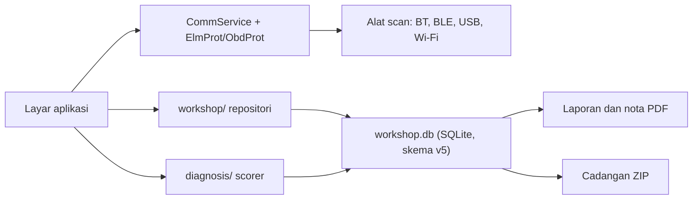

# Bengkel Scan

Aplikasi Android untuk bengkel kendaraan: membaca data OBD-II dari alat scan, mencatat pekerjaan servis, dan
membuat laporan untuk pelanggan — semuanya **offline di satu ponsel** tanpa akun, server, atau langganan.

Dirancang untuk bengkel kecil di Indonesia yang dikerjakan 1–3 mekanik dengan satu ponsel bersama. Antarmuka
berbahasa Indonesia sederhana, tombol besar, dan minim mengetik. Kendaraan yang lebih tua — **diesel injeksi
mekanis tanpa ECU sama sekali** — tetap bisa ditangani lewat checklist gejala, tanpa alat scan.

## Apa yang bisa dilakukan aplikasi ini

**Pemeriksaan OBD-II**

- Baca **Kode Kerusakan** tersimpan, tertunda, dan permanen beserta arti Indonesianya (3.584 kode).
- Lihat **Data Langsung**: nilai sensor, satuan, dan status kesiapan sesuai dukungan kendaraan.
- Lihat **Data Saat Kerusakan** (freeze frame) bila ECU menyediakannya, serta informasi identitas kendaraan.
- Sambungan lewat Bluetooth Classic, Bluetooth LE, USB/OTG, atau Wi-Fi (TCP).
- **Mode Latihan** dengan data simulasi untuk belajar tanpa kendaraan; data contoh selalu diberi label.
- **Simpan pindai** menyalin kode dan data langsung ke satu servis, ditandai pindai nyata/data contoh/berkas,
  plus layar **bandingkan sebelum-sesudah** perbaikan.

**Pekerjaan bengkel**

- **Pelanggan dan kendaraan**: nama, telepon, plat, model, tahun, bahan bakar, nomor rangka/mesin, odometer.
- **Servis** dengan alur *Menunggu → Sedang dikerjakan → Selesai → Lunas*, plus daftar pekerjaan tersaring
  (semua / belum selesai / hari ini / belum lunas) dan hitungannya di beranda.
- **Bagian yang diperiksa**: kondisi Baik / Perlu perhatian / Rusak, catatan, foto kamera atau galeri, dan
  catatan suara maksimal 15 detik.
- **Estimasi**: baris jasa/sparepart, jumlah, harga, diskon per baris, tautan ke bagian yang diperiksa.
- **Paket pekerjaan**: template baris yang bisa disalin ke estimasi untuk pekerjaan yang berulang.
- **Persetujuan pelanggan** per baris (setuju/tolak beserta catatan dan riwayat); hanya baris disetujui yang
  masuk ke nota.
- **Pembayaran**: jumlah diterima, cara bayar, waktu bayar, dan sisa tagihan; pembayaran sebagian tidak pernah
  dianggap lunas.
- **Laporan PDF dan nota** A4 berhalaman, bisa dikirim lewat WhatsApp atau aplikasi lain, plus teks pesan siap
  kirim.
- **Pengingat jatuh tempo** servis berdasarkan tanggal atau odometer, dengan pesan pengingat siap kirim.
- **Cadangkan/pulihkan** seluruh data (database, foto, audio) dalam satu berkas ZIP, dan **ekspor CSV** untuk
  pelanggan, servis, serta nota belum lunas.
- **Profil bengkel** (nama, alamat, telepon, logo, catatan penutup) yang muncul di setiap cetakan.

**Diagnosis tanpa alat scan**

- Checklist gejala untuk kendaraan tanpa ECU: pilih keluhan, jawab pertanyaan pilihan tunggal, lalu baca daftar
  **kemungkinan penyebab** beserta tanda, cara memeriksa, tingkat bahaya, dan alasan urutannya.
- Mekanik mencatat bukti pemeriksaan dan **penilaian akhir sendiri**; konfirmasi ditolak tanpa bukti.
- **Panduan bunyi** offline dengan pemutaran audio dan rekaman bunyi terkait kasus.
- **Kasus serupa** menghitung kasus lain dengan keluhan dan kendaraan yang sama.

Setiap saran diagnosis selalu disertai peringatan: *"Hasil ini hanya saran. Keputusan akhir ada pada mekanik."*

## Yang perlu diketahui sebelum memakai

- **Offline sepenuhnya.** Internet hanya diperlukan bila Anda sengaja mengirim laporan lewat WhatsApp.
- **Satu ponsel, satu database.** Tidak ada akun, sinkronisasi, atau server. Cadangkan ZIP secara rutin; bila
  ponsel hilang, catatan bengkel ikut hilang.
- **Baca-saja.** Aplikasi tidak menyediakan coding, aktivasi aktuator, atau reset SRS/transmisi. Menghapus kode
  kerusakan tersedia, tetapi selalu lewat peringatan dan dicatat di log audit.
- **Isi panduan diagnosis adalah draf** yang belum ditinjau mekanik senior. Aplikasi tidak mengarang angka
  tekanan, torsi, atau spesifikasi; bila acuan tidak ada, layar menyatakan belum tersedia.
- **Bukan pengganti manual kendaraan.** Periksa tegangan sistem (banyak truk 24 V) dan rating alat scan sebelum
  menyambungkan.

## Arsitektur singkat

Tiga modul Gradle:

| Modul | Isi |
| --- | --- |
| `:androbd` | Aplikasi Android: antarmuka, transport, paket `workshop/` (data bengkel) dan `diagnosis/` (diagnosis tanpa ECU) |
| `:library` | Java murni: protokol ELM/OBD, model PID dan kode kerusakan, konversi, process variable |
| `:plugin` | Framework ekstensi (submodule Git), bukan penyimpanan bengkel |



Detail teknis ada di dalam kode (Javadoc kelas dan paket) serta di bagian *Arsitektur aplikasi* pada dokumen ini.

## Menjalankan aplikasi

**Persyaratan:** JDK 17, Android SDK dengan **platform 37**, Gradle memakai wrapper repository, ponsel Android
6.0 (API 23) atau lebih baru.

```bash
export JAVA_HOME=/usr/lib/jvm/java-17-openjdk-amd64
export ANDROID_HOME="$HOME/Android/Sdk"
export PATH="$JAVA_HOME/bin:$ANDROID_HOME/platform-tools:$PATH"

git clone --branch bengkel-custom --recurse-submodules \
  https://github.com/baniputrabangsawan/Bengkel-Scan.git
cd Bengkel-Scan

./gradlew :androbd:assembleDebug
```

Hasil build: `androbd/build/outputs/apk/debug/androbd-debug.apk`.

Pasang ke ponsel dengan USB debugging aktif:

```bash
export ANDROID_SERIAL=<serial dari adb devices -l>
adb install -r androbd/build/outputs/apk/debug/androbd-debug.apk
adb shell am start -W -n com.fr3ts0n.ecu.gui.androbd/.MainActivity
```

Nama di launcher adalah **Bengkel Scan**; package ID tetap `com.fr3ts0n.ecu.gui.androbd`. Bila versi lain
sudah terpasang dengan tanda tangan berbeda, `adb install -r` akan gagal — **cadangkan data lebih
dulu**, dan jangan langsung `uninstall` atau `pm clear`.

Build rilis memakai R8 dan resource shrinking (±3,3 MB) serta memerlukan keystore sendiri; jangan pernah
menaruh berkas keystore atau kata sandinya di repository.

## Pengujian

```bash
./gradlew :library:test :androbd:testDebugUnitTest    # tanpa ponsel
./gradlew :androbd:assembleDebugAndroidTest           # APK tes untuk ponsel
adb shell am instrument -w -e class <FQCN,...> \
  com.fr3ts0n.ecu.gui.androbd.test/androidx.test.runner.AndroidJUnitRunner
```

Jalankan satu kelompok tes per perintah; menggabungkan terlalu banyak kelas dalam satu `am instrument` membuat
proses tes kehabisan waktu pada ponsel bersama walaupun tiap kelas lulus sendiri-sendiri.

## Audio dataset and model research

The Python pipeline is separate from the Android build; it lives under `ml/`.

```sh
uv run --project ml --locked python ml/run.py --config ml/config.json
```

The current manifest contains no eligible training recordings: this command writes an honest blocked
report, not fabricated accuracy. YAMNet is research-only; weight provenance still needs verification.

Phase 5 adds offline TFLite inference and technical validation. Its explicitly named synthetic model
exists only in generated debug/test assets. The UI states "Mode uji teknis, bukan diagnosis"; release
APK builds reject synthetic assets, including renamed models with synthetic metadata.
Technical parity, latency and offline evidence are not vehicle accuracy.

Phase 6 adds result states, conservative safety and local feedback. Cause percentages remain
unavailable until calibrated; debug examples are explicitly labelled. Per-recording consent permits
a separate manual ZIP export, never an automatic upload. Consent can be revoked for future exports;
copies already exported cannot be recalled.

Phase 7 adds optional Bluetooth OBD evidence: fresh same-session PID/DTC observations, explicit
same-vehicle confirmation, explainable draft re-ranking and a non-OBD fallback on disconnect.
Readiness is never presented as a misfire count.


## Struktur repository

```text
androbd/     aplikasi Android (Java 17, minSdk 23, targetSdk 37)
  src/main/java/com/fr3ts0n/ecu/gui/androbd/   beranda, transport, workshop/, diagnosis/
  src/main/res/                                layout, string Indonesia, tema, ikon
  src/main/assets/diagnosis/                   panduan diagnosis bawaan (JSON)
  src/test/, src/androidTest/                  tes JVM dan tes di ponsel
library/     protokol ELM/OBD dan model data (Java murni)
plugin/      framework plugin (submodule)
gradle/      wrapper Gradle yang dipin
```

## Lisensi

Aplikasi ini adalah perangkat lunak bebas di bawah **GNU General Public License v3.0** (lihat `LICENSE`).
Hak cipta serta pemberitahuan lisensi pada berkas source dipertahankan. Bila Anda mendistribusikan build turunan,
penuhi kewajiban GPL, termasuk menyediakan corresponding source.
